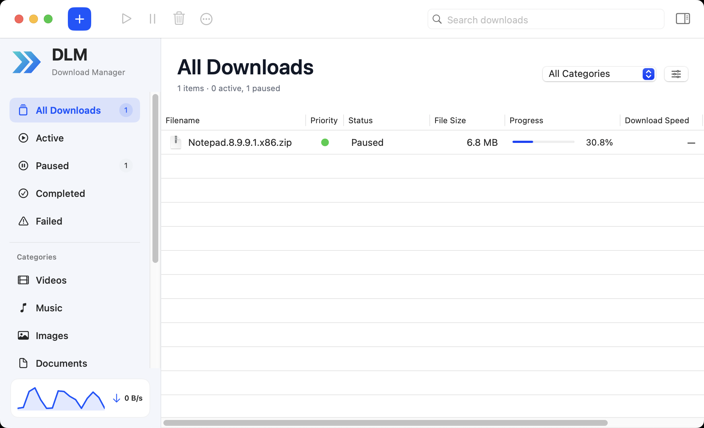

<p align="center">
  
</p>

<h1 align="center">DLM</h1>
<p align="center"><strong>Downloads, under control.</strong></p>
<p align="center">A native macOS download manager with a SwiftUI/AppKit interface and a Rust engine.</p>
<p align="center">
  <a href="https://get-dlm.pages.dev/">Official website</a> ·
  <a href="https://github.com/mr3amuel/DLM/releases/latest">Download DLM</a> ·
  <a href="#installation">Installation</a> ·
  <a href="#license--security">License &amp; security</a>
</p>

[](docs/images/dlm-macos.png)

*The native macOS interface. Select the screenshot to view it at full resolution.*

## Download

**Free to download and use. Requires macOS 13 or later.**

Choose the DMG for your Mac from the [latest official release](https://github.com/mr3amuel/DLM/releases/latest):

| Your Mac | Download asset |
| --- | --- |
| Apple Silicon — M-series | [DMG ending in `macOS-arm64.dmg`](https://github.com/mr3amuel/DLM/releases/latest) |
| Intel | [DMG ending in `macOS-x86_64.dmg`](https://github.com/mr3amuel/DLM/releases/latest) |

Each DMG has a `.sha256` checksum file. A matching checksum verifies file integrity; it does not independently establish publisher identity or safety.

## Features

- **Manage transfers:** HTTP/HTTPS downloads, adaptive multi-connection transfers, pause/resume where supported, and safely verified replacement-link recovery.
- **Control the queue:** priorities, concurrency limits, batch actions, and global or per-download speed limits.
- **Keep files organized:** built-in and custom categories, optional destination rules, and duplicate checks before creation.
- **Plan ahead:** one-time starts, recurring weekly windows, missed-schedule review, and time-based bandwidth rules.
- **Stay in control:** sortable native download table, filename/URL search, status/category/size filters, download details, and a Menu Bar Download Center.
- **Make it yours:** Light, Dark or system appearance, plus English and Persian with right-to-left support.

Resume and recovery depend on server support and compatible resource identity. DLM does not promise that every interrupted transfer can resume.

## Installation

1. Download the matching DMG from the [official release](https://github.com/mr3amuel/DLM/releases/latest).
2. Quit any running DLM instance before replacing it.
3. Open the DMG and drag **DLM.app** to **Applications**.
4. Open DLM from Applications.

**DLM 0.1.0 is ad-hoc signed. It is not Developer ID signed or notarized by Apple.** macOS may block first launch because the developer cannot be verified.

If you trust the official download, attempt to open it, then follow [Apple's per-app approval guidance](https://support.apple.com/102445): use **System Settings → Privacy & Security → Open Anyway** where available, and confirm the prompt. Availability depends on macOS and organization policy. Do not override malware/damaged-app warnings or disable Gatekeeper globally.

There is **no automatic updater**; install later versions manually after quitting DLM. Folder permissions may need renewed consent after ad-hoc rebuilds.

Downloads and schedules work only while the DLM application process is running. Closing the main window may leave DLM active in the menu bar; **Quit DLM** stops transfers and saves recovery state. There is no separate background download daemon.

## Browser integration

Optional browser integration sends a link to DLM for review before downloading. Use **Settings → Browsers** for Chrome setup; installation and authenticated pairing require explicit user actions. Cookies and authorization headers are not forwarded by default, and downloads are not automatically intercepted.

Chrome/Edge installation uses a developer-mode extension. Permanent Firefox installation requires Mozilla signing. Installing DLM does not automatically install or register a browser extension.

## Source & development

The public repository contains the native macOS application and shared Rust engine. See the [source layout](docs/LAYOUT.md) and [release documentation](docs/RELEASE.md).

<details>
<summary>Build and focused checks</summary>

For source review and authorized builds, use Xcode with its command-line tools, Python 3, and the pinned Rust toolchain in [rust-toolchain.toml](rust-toolchain.toml). Build on matching Apple Silicon or Intel macOS hardware:

```sh
DLM_NATIVE_CONFIGURATION=production DLM_NATIVE_SANDBOX=0 ./prototypes/swiftui/build.sh release
```

Output: `prototypes/swiftui/build/DLM.app`. Development builds use `DLM_NATIVE_CONFIGURATION=development` and retain a separate application identity and data directory.

Focused checks, without launching the application:

```sh
./prototypes/swiftui/test_lifecycle.sh
python3 scripts/release/test_release.py
node --test browser-extension/tests/*.test.cjs
```

Rust tests are under `crates/download_core/tests` and `prototypes/swiftui/bridge`. Production metadata and recovery state live outside the app bundle, under `~/Library/Application Support/com.dlm.native`; downloaded files use their selected destinations. Replacing the app does not reset these records. No automatic import of another application's history is included.

</details>

## License & security

Official DLM binaries are **free to download and use**. DLM's proprietary source is **source-available, not open-source licensed**: public viewing does not grant permission to copy, modify or redistribute proprietary DLM code. See [Source Availability](SOURCE_AVAILABILITY.md).

Third-party components retain their own licenses and rights. See [Third-Party Notices](THIRD_PARTY_NOTICES.md); preserved legal texts also ship inside `DLM.app/Contents/Resources/ThirdPartyNotices`.

For vulnerabilities, follow [SECURITY.md](SECURITY.md). Do not post credentials, private download URLs, databases, pairing material or personal logs in public issues. Use GitHub's private reporting option only when it is available; otherwise do not submit sensitive details publicly.
